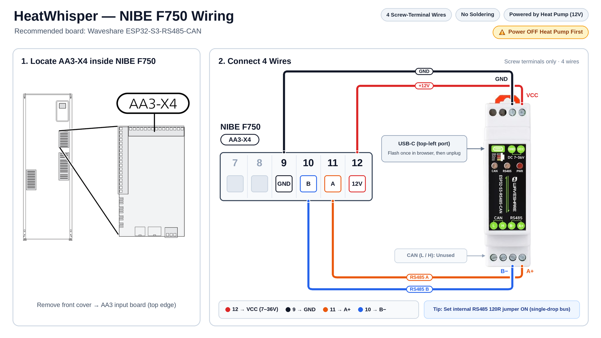

# HeatWhisper

Heat Whisper is a software that lets you read and control your heat pump locally. The main focus is to integrate Nibe heatpumps from the F-series to Home Assistant. It is possible to configure Heat Whisper to communicate over MQTT to support other systems apart from Home Assistant.

This project doesn't include any logic for smart control itself, the purpose is instead to expose any supported register to be read or written to by the smart home system of your choice. If you are running e.g. Home Assistant you can set up your control logic based on electricity prices, weather forecast, solar production and whatever you like.

The project is based on ESPHome and emulates Nibe's own Modbus 40-unit by communicating with the heat pump over RS485.

## Works with

HeatWhisper is a zero-logic local bridge designed to plug directly into external energy optimizers and smart home platforms:

- **[Home Assistant](https://www.home-assistant.io/)** — Native [ESPHome](https://esphome.io/) API with zero-config discovery.
- **[EnergyWizard](https://github.com/murre87/energywizard)** — Ready out of the box with the 17 default entities (set `curve_offset: number.heatwhisper_heat_offset_s1`, plus outdoor, supply, return, room, and hot-water sensors).
- **[EffektGuard](https://github.com/enoch85/EffektGuard)** — Works directly against the default outdoor, supply, return, room, degree-minute, electrical-addition, priority, and offset entities.
- **[EMHASS](https://github.com/davidusb-geek/emhass)** — Expose temperature/power sensors and automate heat offset, hot water comfort mode, or additive heating schedules.
- **[MQTT](https://mqtt.org/) / [Node-RED](https://nodered.org/)** — Opt-in MQTT broker support in `packages/base.yaml` with automatic Home Assistant discovery and per-entity state topics.

**EEPROM protection:** HeatWhisper deduplicates no-op writes (comparing against the pump's last known register state) and coalesces rapid pending updates in firmware, protecting your NIBE EEPROM when external optimizers resend identical setpoints on 1–5 minute loops.

You can support the project by:
* Joining as a developer
* Using one of the affiliate-links to purchase a compatible board
* Using my Tibber link: https://invite.tibber.com/bdh8hhil if you're thinking about switching to them

# Supported boards

Boards: ESP32-S3 RS485-CAN (`heatwhisper_esp32_s3_rs485.yaml`), ESP32 (`heatwhisper_esp32.yaml`), and Raspberry Pi Pico W (`heatwhisper_pico_w.yaml`).

Recommended board is the Waveshare ESP32-S3 with RS485/CAN, it requires no soldering and no addons and is as close to plug n' play as you can get. You get the device, connect it to a computer using USB, flash the board directly from the web and wire it as instructed below and you're all set!

You can support the project by using an affiliate link to purchase your esp-board:
- https://link.amazon/B0dxQyUfV (Recommended Waveshare ESP32-S3 With RS485)

*As an Amazon Associate, I earn from qualifying purchases*

Or go to Amazon/AliExpress or any other place where you can find ESP32 boards and look for "waveshare esp32-s3 rs485".

For other ESP32-boards or Raspberry pi pico W you need to get a RS485 HAT as well as a converter for handling 12V to board input voltage.

## Supported heat pumps

Brand: **NIBE** F-series.

Auto-detected from the pump's announcement frame — no model setting needed. If your model is not listed, the bridge still runs with a generic register set.

| Family | Models |
|---|---|
| F ground-source | F1145, F1155, F1245, F1255, F1345, F1355 |
| F exhaust-air | F370, F470, F730, F750 |
| Indoor modules | VVM225, VVM310, VVM320, VVM325, VVM500 |

Register maps live in `components/heatwhisper/models/*.json` (All NIBE models above, other files are there as a reference for now).

## What you need
Prerequisites
- NIBE pump with a free RS485 port
- Home Assistant (or other smart home system that works with ESPHome or has MQTT-support)

Hardware
- [Waveshare ESP32-S3 with RS485](https://link.amazon/B0dxQyUfV) (affiliate link) - This device includes everything you need!

OR

- ESP32, ESP32-S3, or Raspberry Pi Pico W
- RS485-to-TTL transceiver (pump RS485 A/B → transceiver → MCU UART, 9600 8N1)
- Voltage converter 12v -> board input voltage

| Board | TX | RX | Flashing |
|---|---|---|---|
| ESP32 (`esp32dev`) | GPIO17 | GPIO16 | `esphome run` or web flasher |
| ESP32-S3 RS485-CAN (`esp32-s3-devkitc-1`) | GPIO17 | GPIO18 (EN GPIO21) | `esphome run` or web flasher |
| Pico W (`rpipicow`) | GPIO4 | GPIO5 | `firmware.uf2` via USB mass-storage (BOOTSEL) |

Optional `flow_control_pin` under `heatwhisper:` (e.g. GPIO18) for DIY transceivers needing manual direction control. Without it, an auto-direction transceiver is assumed. This is separate from the ESP32-S3 RS485-CAN package, which sets UART-level `flow_control_pin: GPIO21` in `packages/esp32_s3_rs485.yaml` (onboard transceiver needs manual DE — not auto-direction).

## Getting started (single flash, no secrets file)

### 1. Flash from the browser

Go to the GitHub Pages flasher [Stable](https://burken-dev.github.io/heat-whisper/) or [Beta](https://burken-dev.github.io/heat-whisper/beta/), connect to the board using USB and click "Connect". The manifest picks ESP32 vs ESP32-S3 automatically. After flashing, click **Configure Wi-Fi** (Improv over USB). Skipped it? Join the fallback AP `HeatWhisper` (password `heatwhisper01`) and pick your network in the captive portal.

Local build instead: `esphome run heatwhisper_esp32_s3_rs485.yaml` (or `heatwhisper_esp32.yaml`). No `secrets.yaml` needed — the factory image ships open (no API key, no OTA/web passwords) so HA can discover it. Add passwords after adoption (see Hardening).

### 2. Wire it up



With the recommended **Waveshare ESP32-S3-RS485-CAN**, installation is just **4 screw-terminal wires** — no soldering, no external RS485 transceiver, and no separate power supply (its 7–36 V input runs directly off the heat pump's 12 V bus):

| NIBE F750 (`AA3-X4`) | Signal | Waveshare ESP32-S3-RS485-CAN |
|---|---|---|
| **Pin 12** | `+12V` | **`VCC` (`DC 7~36V`)** *(top right)* |
| **Pin 9** | `GND` | **`GND` (`DC 7~36V`)** *(top, next to `VCC`)* |
| **Pin 11** | `RS485 A` | **`A+` (`RS485`)** *(bottom right)* |
| **Pin 10** | `RS485 B` | **`B-` (`RS485`)** *(bottom, next to `A+`)* |

*(Leave CAN `H`/`L` unconnected. Unclip the case and move the onboard **RS485 `120R`** jumper to **ON** for a single-drop bus. Unplug USB-C after flashing.)*

1. Turn off the heat pump.
2. Remove the top cover (like when you're about to clean the filter).
3. Look on the bottom of the heat pump, unscrew the two screws, and lift the front cover off.
4. Open the latch and connect the 4 wires to `AA3-X4` as shown in the diagram and table above.
5. Power on the heat pump and check that HeatWhisper powers up.
6. Hold down the "back" button until the service menu appears, go to **5.2**, and activate **MODBUS 40**.

Using another NIBE model (`F1145`, `F1245`, `F1345`, `VVM`, etc.)? Check the MODBUS 40 [installation manual](https://assetstore.nibe.se/hcms/v2.4/entity/document/23567/storage/MDIzNTY3LzAvbWFzdGVy/download/Installat%C3%B6rshandbok_Tillbeh%C3%B6r_MODBUS%2040_031725-10.pdf) for your model's terminal block (`AA3-X4:9–12` on most F/VVM models; `X6` or `AA101-X10` on F1345/F1355).

**Using a DIY ESP32 or Pico W instead?** The heat pump supplies **12 V** on pin 12, so use a 12 V-to-5 V/3.3 V buck converter to power the board and wire pump RS485 A/B → external RS485 transceiver → MCU UART pins from the table above (power the transceiver at 3.3 V or 5 V per module).

### 3. Add it to Home Assistant

Settings → Devices & Services → ESPHome — the node appears automatically (no API key on factory image). Click Add. The pump model is autodetected from its announcement (`Heat Pump Model` sensor, empty until first heard) — no model setting, no Modbus vs NIBE choice for NIBE pumps.

**Caveat:** Don't get greedy with settings and changing them to new values too often! Think hours instead of minutes when creating your logic to not wear out the EEPROM in the Nibe. (Repeated identical writes are automatically deduplicated in firmware.)

### 4. Pick registers

1. Open `http://<node>/heatwhisper/registers`, check what to expose (max 50), save, reboot (via the ESPHome restart button).
2. The selection is stored in flash and survives OTA. Fewer registers = faster poll cycle, so enable only what you need.

Registers are categorized into four safety tiers (`Read-only`, `Control`, `Installer`, and `High Risk`). `Installer` and `High Risk` registers are hidden behind an opt-in checkbox by default (unless already enabled or matched by an exact 4–5 digit register search), and enabling any writable `Installer`, `High Risk`, or unclamped (`No range`) register shows one summary confirmation on Save. Any `R/W` register can also be toggled to **Read-only (sensor)** in the picker so you can monitor it in Home Assistant without exposing write controls; registers missing catalog `min`/`max` bounds default to Read-only and fall back to integer type bounds if explicitly made writable.

The page also holds the other runtime settings (all saved to flash, reboot to apply): NIBE model pin / Autodetect (pins the catalog filter until the next pump announcement overwrites it), Modbus-RTU setup (see below), and a `Reset pump alarm` button (writes 1 to 45171 — NIBE models only).

Done — sensors appear in Home Assistant and writable registers appear as numbers/switches/selects.

### Hardening (optional, after adoption)

Adopt in the ESPHome dashboard (`dashboard_import` is built in), then add `api` encryption, `ota` password, and `web_server` auth and reflash OTA. `secrets.yaml.example` documents the optional extras (MQTT).

### Troubleshooting

- No values? Check A/B wiring (try swapping), confirm decoded temps at `http://<node>`, then re-check the pump port.

## Entity & Register Reference

All three board configs (`heatwhisper_esp32.yaml`, `heatwhisper_esp32_s3_rs485.yaml`, `heatwhisper_pico_w.yaml`) share `name: heat-whisper` and `friendly_name: HeatWhisper`, so Home Assistant entity IDs and the `heat-whisper.local` mDNS hostname are identical on every supported board.

> **Upgrading from an older ESP32-S3 or Pico W build?** Earlier releases used `heat-whisper-s3` / `heat-whisper-pico`. After updating, the mDNS hostname unifies to `heat-whisper.local`; existing Home Assistant entity IDs already stored in Home Assistant's entity registry remain intact.

Created at first boot (**17 registers**; stored in NVS flash, survives OTA — devices that already saved a custom selection keep theirs):

| Register | HA Entity ID | Type / Unit | Values / Notes |
|---|---|---|---|
| `40004` | `sensor.heatwhisper_bt1_outdoor` | `sensor` (`°C`) | BT1 outdoor temperature (0.1 °C) |
| `40008` | `sensor.heatwhisper_supply_temp_s1` | `sensor` (`°C`) | Supply temperature, climate system 1 (0.1 °C) |
| `40012` | `sensor.heatwhisper_return_temp` | `sensor` (`°C`) | Return temperature (0.1 °C) |
| `40013` | `sensor.heatwhisper_hot_water_top_bt7` | `sensor` (`°C`) | Hot water top temperature BT7 (0.1 °C) |
| `40014` | `sensor.heatwhisper_hot_water_bt6` | `sensor` (`°C`) | Hot water load temperature BT6 (0.1 °C) |
| `40033` | `sensor.heatwhisper_room_temp_s1` | `sensor` (`°C`) | Room temperature BT50, climate system 1 (0.1 °C) |
| `43005` | `number.heatwhisper_degree_minutes` | `number` | Degree minutes (`-3000`…`3000`, step `0.1`, R/W) |
| `43009` | `sensor.heatwhisper_calculated_supply` | `sensor` (`°C`) | Calculated supply temperature, S1 (0.1 °C) |
| `43084` | `sensor.heatwhisper_electrical_addition_power` | `sensor` (`kW`) | Internal electrical addition power (0.01 kW) |
| `43086` | `sensor.heatwhisper_operating_priority` | `sensor` | Operating priority code: `10`=Off, `20`=Hot Water, `30`=Heat, `40`=Pool, `41`=Pool 2, `50`=Transfer, `60`=Cooling |
| `45001` | `sensor.heatwhisper_alarm` | `sensor` | Active alarm code (`0` = no alarm) |
| `47011` | `number.heatwhisper_heat_offset_s1` | `number` | Heat curve offset S1 (`-10`…`10`, step `1`, R/W) |
| `47041` | `select.heatwhisper_hot_water_comfort_mode` | `select` | `Eco` (`0`), `Normal` (`1`), `Luxury` (`2`), `Smart` (`4`) |
| `47370` | `switch.heatwhisper_allow_additive_heating` | `switch` | Allow additive heating (`0`/`1`) |
| `47371` | `switch.heatwhisper_allow_heating` | `switch` | Allow heating (`0`/`1`) |
| `47387` | `switch.heatwhisper_hot_water_production` | `switch` | Hot water production (`0`/`1`) |
| `48132` | `select.heatwhisper_temporary_lux` | `select` | `Off` (`0`), `3h` (`1`), `6h` (`2`), `12h` (`3`), `One time` (`4`) |

### Built-in device entities

| Name | HA Entity ID | Kind | Notes |
|---|---|---|---|
| `Heat Pump Model` | `sensor.heatwhisper_heat_pump_model` | diagnostic `text_sensor` | Autodetected from pump `0x6D` announcement (empty until heard) |
| `HeatWhisper version` | `sensor.heatwhisper_heatwhisper_version` | diagnostic `text_sensor` | Firmware release tag (or `"dev"` for local builds) |
| `Log Level` | `select.heatwhisper_log_level` | config `select` | Runtime ESPHome log level |
| `Restart HeatWhisper` | `button.heatwhisper_restart_heatwhisper` | config `button` | Reboots the bridge |
| `Factory Reset HeatWhisper WiFi` | `button.heatwhisper_factory_reset_heatwhisper_wifi` | config `button` | Clears Wi-Fi credentials and starts fallback AP |
| `Reset Heat Pump Alarm` | `button.heatwhisper_reset_heat_pump_alarm` | config `button` | Writes `1` to register `45171` (always sent, not deduplicated) |
| `Firmware Update` | `update.heatwhisper_firmware_update` | `update` | Managed OTA from release manifest (ESP32 & ESP32-S3 only; Pico W uses manual `.uf2`) |

Smart-control recipe: cheap/solar surplus → raise `47011` (`+2`…`+3`) and set `47041` = `Luxury`, ensure `47371`/`47370` = ON; expensive → lower `47011`, set `47041` = `Eco`, set `47370` = OFF. Prefer `number.heatwhisper_heat_offset_s1` (`47011`) over raw `43005` writes.

## Configuration

```yaml
heatwhisper:
  id: heatwhisper_bridge
  uart_id: heatwhisper_uart
  # flow_control_pin: GPIO18  # heatwhisper-level DE pin for DIY transceivers (S3 package uses UART-level GPIO21 instead)
  # extra_poll: [10001]    # poll-without-entity (sniffing)
```

Writes to addresses below 20000 (1xxxx range) are dropped by design.

MQTT (off by default — uncomment block at bottom of `packages/base.yaml`): each entity publishes to its native state topic automatically. Optional `topic_prefix: "heatwhisper"`; HA discovery is automatic, `discovery: false` disables it.

## Modbus-RTU (advanced: non-Nibe and Nibe MODBUS40)

Default is NIBE slave with autodetect — most users stop here. Only for MODBUS40 accessory or non-NIBE pumps (Lambda/Thermia/…), open `http://<node>/heatwhisper/registers`, pick the model under Modbus-RTU setup, Detect & save, reboot. No recompile; the section is emphasized while no NIBE model is heard. YAML alternative (recompile):

```yaml
heatwhisper:
  protocol: modbus_rtu
  model: F750        # required in modbus mode
  modbus_address: 1  # peer address
```

Nibe MODBUS40 wiring: MODBUS40 accessory X2 terminals → RS485 A/B transceiver, 9600 8N1; enable MODBUS40 in the pump installer menu. Writes to MODBUS40 models use FC16 only, never FC06 (enforced from `transports.json` `write_fc`). The picker (`/heatwhisper/registers`) tags each model with `"proto": "nibe"|"modbus"` and, in modbus mode, lists the configured model's registers.

Lambda EU-L (EU08/13/15/20/35L) needs no accessory (native RTU); bridge default is 19200 EVEN (see `transports.json`). Writes use FC16 only. Note: the pump requires buffer-demand regs 3006–3008 (+3009) to be written together in one FC16 frame, but the bridge sends one single-register FC16 per write — so don't expose 3006–3009 as separate number entities and expect block semantics.

## Build / test / release

```bash
pip install -r requirements.txt   # pinned ESPHome (same version CI uses)
python -m pytest tests/ -v
esphome config heatwhisper_esp32.yaml
esphome config heatwhisper_esp32_s3_rs485.yaml
esphome config heatwhisper_pico_w.yaml
esphome compile heatwhisper_esp32.yaml
# clear .esphome/build/heat-whisper between different boards (all share name: heat-whisper)
esphome compile heatwhisper_esp32_s3_rs485.yaml
esphome compile heatwhisper_pico_w.yaml
```

CI (`.github/workflows/build.yml`): pytest → `esphome config` + `compile` all three boards → artifacts on tags attached to the GitHub release + deployed to GitHub Pages (web flasher).

**Staying current with ESPHome:** the ESPHome version is pinned in `requirements.txt`. Dependabot opens a weekly PR when a new stable ESPHome is out (plus PRs for GitHub Actions updates); PR CI runs the tests and compiles all boards. Merging an ESPHome bump to `main` automatically tags and publishes a **beta** (`.github/workflows/beta-on-bump.yml` → `scripts/release.sh beta auto`). Promote to stable manually with `scripts/release.sh stable patch|minor|major`.

## Troubleshooting

- No values? Check wiring (try swapping A/B), check logs / `web_server` :80 (switch Log Level to DEBUG), confirm the pump port is enabled.
- Writes ignored for addr < 20000: dropped by design, never sent.
- `Heat Pump Model` empty: pump hasn't sent its announcement yet — wait a minute.
- Wi-Fi wrong? Wait for the fallback AP, press Factory Reset Wi-Fi (`button`), or re-run Improv; fallback AP is `HeatWhisper` / `heatwhisper01`.

## Thanks to
This project is inspired by [NibePi](https://github.com/anerdins/nibepi). Big thanks for the register mappings and such!

License: MIT. Register maps vendored under their own MIT license (`components/heatwhisper/models/LICENSE`).
